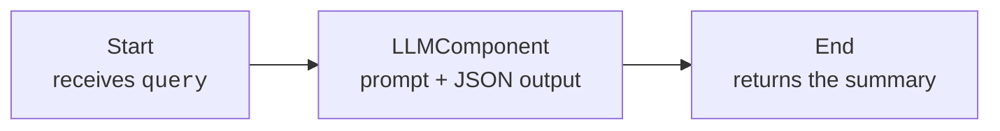
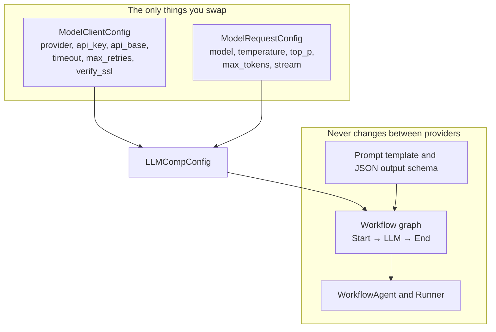

# Switching LLM Providers in openJiuwen Agent Core

A small, runnable demo showing that you can move an [openJiuwen Agent Core](https://github.com/openJiuwen-ai/agent-core) agent from one LLM provider to another (here: OpenAI → DeepSeek) by changing **two config objects**, without touching the workflow, the prompt, or the agent.

## The idea in one paragraph

Many LLM code hard-wires "where the model lives" (URL, API key, retries) and "how it should answer" (model name, temperature, token limit) into the same place as the application logic, so changing provider means editing everything. Agent Core keeps those concerns apart: a `ModelClientConfig` describes the **connection**, a `ModelRequestConfig` describes the **sampling behaviour**, and both are handed to a workflow component that knows nothing about either. 

This repo builds one tiny summarisation agent, runs it against OpenAI, then runs the *identical* agent against DeepSeek by passing different config objects, and finally shows a registry that picks the provider by name at runtime.

## What the agent does

It takes a piece of text and returns a one-sentence summary. Internally it is a three-step workflow:



The `LLMComponent` is the only step that talks to a model, and it is built from the two swappable configs:



## The three scenarios

| # | File | What it shows |
|---|---|---|
| 1 | [src/baseline_agent.py](src/baseline_agent.py) | The reference setup: agent backed by OpenAI `gpt-4o`. |
| 2 | [src/provider_swap.py](src/provider_swap.py) | The same agent backed by DeepSeek `deepseek-chat`. Only the two config builders differ; the lines that build the workflow, create the agent and run it are identical to scenario 1. |
| 3 | [src/multi_model.py](src/multi_model.py) | A small registry (`"openai"` / `"deepseek"` → config factory) so the provider is chosen by alias at runtime. It also shows `extra_body`, for provider-specific request fields that are not part of the standard interface. |

Shared code lives in [src/workflow_builder.py](src/workflow_builder.py), which builds the graph, the prompt and the agent. [src/main.py](src/main.py) runs the three scenarios in order and checks that the needed API keys are set first.

## Setup

**Requirements:** Python 3.11, 3.12, or 3.13 (developed on 3.12) and API keys for OpenAI and DeepSeek.

```bash
git clone https://github.com/draftdev/huawei-openjiuwen--agent-cores-fix-for-switching-llm-providers-without-rew
cd huawei-openjiuwen--agent-cores-fix-for-switching-llm-providers-without-rew
python -m venv .venv && source .venv/bin/activate
pip install -r requirements.txt
```

`requirements.txt` installs `workswarm`, which brings in `openjiuwen` (the Agent Core library the code imports), plus `pytest`. The scripts in `src/` import only `openjiuwen`.

### API keys

The code reads keys from **environment variables**. It does not load a `.env` file by itself, so export them in your shell first:

```bash
export OPENAI_API_KEY=sk-...
export DEEPSEEK_API_KEY=sk-...

# Optional: override the default endpoints
export OPENAI_API_BASE=https://api.openai.com/v1
export DEEPSEEK_API_BASE=https://api.deepseek.com
```

If you keep the keys in a `.env` file, load them into your shell with `set -a; source .env; set +a`. Never commit real keys.

## Running it

Run everything from the **repository root**, using `-m` so that the `src` package imports resolve:

```bash
python -m src.main               # all three scenarios in order
python -m src.baseline_agent     # scenario 1 only (needs OPENAI_API_KEY)
python -m src.provider_swap      # scenario 2 only (needs DEEPSEEK_API_KEY)
python -m src.multi_model        # scenario 3 only (needs both keys)
```

### What you'll see

Agent Core logs a lot of INFO lines, so the useful output is easy to miss. Look for the lines that start with the provider name, one per scenario (summaries trimmed here, yours will vary):

```text
[OpenAI gpt-4o] {'response': 'Agent Core separates connection and inference configurations to allow provider switching ...'}
[DeepSeek deepseek-chat] {'response': 'Agent Core separates connection configuration (ModelClientConfig) from inference ...'}
[openai — default] {'response': 'The dual-config architecture separates provider topology and inference behavior ...'}
[deepseek — alternative] {'response': 'The dual-config architecture enforces a type-level separation between provider topology ...'}
```

**Note:** Two log lines look alarming but are harmless: `ERROR ... add resource failed ... resource already exist` appears once per agent built. The workflow is registered twice inside the library and the second attempt is rejected. The next log line says `Successfully added workflow instance` and the run completes normally.

## Tests

The tests make **no API calls** and need no LLM keys. They check that the Agent Core classes import and that the config objects can be built with the expected parameter names.

```bash
pytest -v
```

```text
tests/test_smoke.py::test_model_client_config_import PASSED              [  9%]
tests/test_smoke.py::test_model_request_config_import PASSED             [ 18%]
tests/test_smoke.py::test_workflow_imports PASSED                        [ 27%]
tests/test_smoke.py::test_runner_import PASSED                           [ 36%]
tests/test_smoke.py::test_workflow_agent_imports PASSED                  [ 45%]
tests/test_smoke.py::test_model_client_config_instantiation PASSED       [ 54%]
tests/test_smoke.py::test_model_request_config_instantiation PASSED      [ 63%]
tests/test_smoke.py::test_model_request_config_extra_body PASSED         [ 72%]
tests/test_smoke.py::test_generate_workflow_key PASSED                   [ 81%]
tests/test_smoke.py::test_workflow_card_and_workflow_instantiation PASSED [ 90%]
tests/test_smoke.py::test_llm_comp_config_correct_param_name PASSED      [100%]
============================== 11 passed ==============================
```

Passing tests do not prove the live provider calls work. For that, run the scenarios above with real keys.

## Project layout

```text
.
├── .github
│   └── workflows
│       └── verify.yml        CI workflow that runs the tests
├── src
│   ├── __init__.py           makes src a package (needed for python -m src.main)
│   ├── main.py               runs all three scenarios, checks API keys first
│   ├── workflow_builder.py   shared part: graph, prompt, output schema, agent
│   ├── baseline_agent.py     scenario 1: OpenAI
│   ├── provider_swap.py      scenario 2: DeepSeek
│   └── multi_model.py        scenario 3: pick a provider by alias
├── tests
│   ├── __init__.py           makes tests a package
│   └── test_smoke.py         offline import and config tests
├── .env.example              template for the API keys you export
├── pytest.ini                test discovery settings and warning filters
├── README.md                 this file
└── requirements.txt          pinned dependencies
```

## How to read the code

1. Start with [src/workflow_builder.py](src/workflow_builder.py). `build_llm_comp_config` is where the two configs meet the prompt, and `build_workflow` wires Start → LLM → End.
2. Read [src/baseline_agent.py](src/baseline_agent.py) top to bottom. It is the six-step recipe: build two configs, build the workflow, build the agent, run it.
3. Diff it against [src/provider_swap.py](src/provider_swap.py). Only the config builders (provider, key, URL, model name) change, which is the point of the demo.
4. Finish with [src/multi_model.py](src/multi_model.py) to see the same idea turned into "choose a provider by name".

## Adding another provider

Add a function in `src/multi_model.py` that returns a `(ModelClientConfig, ModelRequestConfig)` pair for the new provider, then register it in `_PROVIDER_FACTORIES`. The workflow and agent code stay as they are. This works for providers that expose an OpenAI-compatible API. Check `client_provider` values supported by your installed `openjiuwen` version.

## Common problems

| Symptom | Cause and fix |
|---|---|
| `[ERROR] Missing environment variables: ...` | The key isn't exported in the current shell. See [API keys](#api-keys). |
| `unexpected keyword argument 'extra_fields'` | Provider-specific request fields must go in `extra_body`, not `extra_fields`. |


---